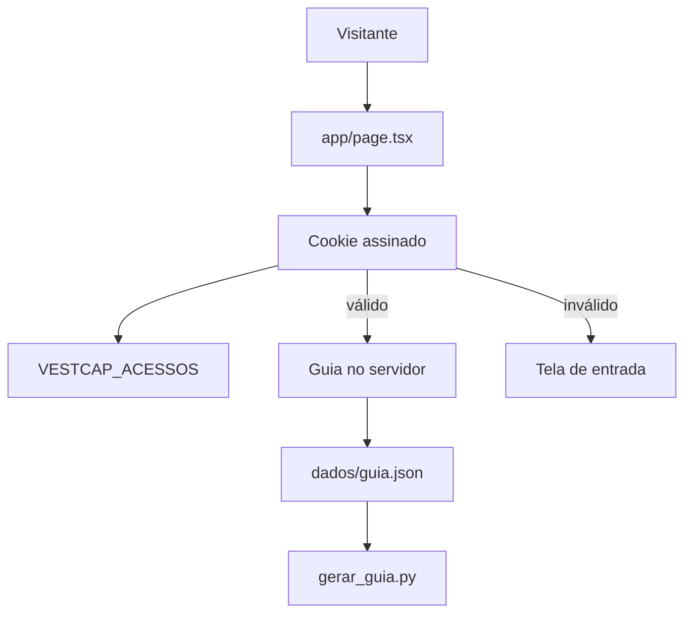

# Página fechada Design

**Spec**: `.specs/features/pagina-fechada/spec.md`
**Status**: Draft

---

## Architecture Overview

A Vercel hospeda um app Next.js (App Router). A checagem do código roda no servidor. O HTML de quem não entrou não inclui os contatos. O PDF continua saindo de `gerar_guia.py` na máquina local.

O `http.server` em Python não sobe na Vercel: lá a aplicação é um deploy do Next, não um processo permanente.



`mermaid-studio` não está instalado. O diagrama acima é o fonte. Se quiser SVG a partir dele, vale instalar o mermaid-studio.

---

## Code Reuse Analysis

### Existing Components to Leverage

| Component | Location | How to Use |
| --- | --- | --- |
| CONTATOS e TEXTOS | `gerar_guia.py` | Fonte única. Um script local grava `web/dados/guia.json` |
| Regra de liberar | `acesso.py` | O comportamento passa para `web/lib/acesso.ts`. O módulo Python deixa de ser o servidor |
| whatsapp wa.me | `gerar_guia.py` `whatsapp_url` | A página monta `https://wa.me/` só com os dígitos |

### Integration Points

| System | Integration Method |
| --- | --- |
| Vercel | Raiz do projeto no painel: `web`. Variáveis `VESTCAP_SEGREDO` e `VESTCAP_ACESSOS` |
| PDF | Não entra no deploy. Continua `python3 gerar_guia.py` |

---

## Components

### liberar

- **Purpose**: Decide se um código entra e de qual pessoa é
- **Location**: `web/lib/acesso.ts`
- **Interfaces**: `liberar(codigo, acessos) => id | null`
- **Dependencies**: nenhuma
- **Reuses**: a regra já testada em `test_acesso.py`

### Sessão

- **Purpose**: Cookie assinado com `VESTCAP_SEGREDO`. Cada abertura relê se o código segue ativo
- **Location**: `web/lib/sessao.ts`
- **Interfaces**: gravar id, ler id ou null
- **Dependencies**: `crypto` do Node
- **Reuses**: nada do PDF

### Página

- **Purpose**: Entrada ou guia, no mesmo endereço
- **Location**: `web/app/page.tsx`
- **Interfaces**: sem cookie válido, só o formulário; com cookie, o guia
- **Dependencies**: `dados/guia.json` importado só no servidor (`server-only`)
- **Reuses**: campos de `CONTATOS` e `TEXTOS`

### Exportação

- **Purpose**: Copiar o dado do PDF para o JSON da página
- **Location**: `exportar_dados.py`
- **Interfaces**: lê `gerar_guia.py`, escreve `web/dados/guia.json`
- **Dependencies**: reportlab, só na máquina local
- **Reuses**: `CONTATOS`, `TEXTOS`

---

## Data Models

```ts
type Acesso = { id: string; codigo: string; ativo: boolean }
```

`VESTCAP_ACESSOS` é um JSON com essa lista. Não vai para o git. Desligar uma pessoa é `ativo: false` e um novo deploy, porque a Vercel publica o que está no ambiente no momento do deploy.

O guia JSON repete `contatos` e `textos` já serializáveis em `gerar_guia.py`.
