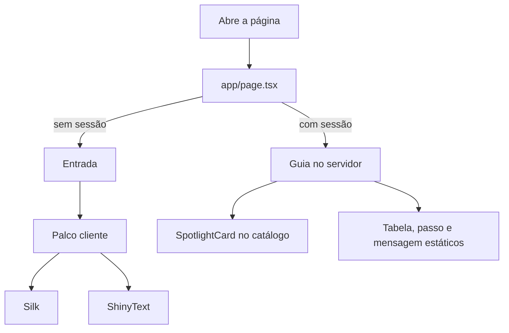

# Visual de impacto Design

**Spec**: `.specs/features/visual-impacto/spec.md`
**Status**: Draft

---

## Architecture Overview

O impacto fica em ilhas de cliente. O servidor continua decidindo se a pessoa entrou. A tela de entrada monta o palco com texto fixo da marca. O guia só monta o cartão de catálogo depois da sessão. Nenhum componente visual importa `web/lib/dados.ts` nem `web/dados/guia.json`.

A variante é TypeScript + CSS, a do registro `*-TS-CSS`. O app não ganha Tailwind. React Bits Pro fica de fora.

Conferidos no registro em 2026-10-26, com `"dependencies": []` e `"use client"`:

| Componente | Registro | O que a página usa |
| --- | --- | --- |
| Silk | `https://reactbits.dev/r/Silk-TS-CSS.json` | Fundo da entrada. `color="#145C38"`, `sheenColor="#DCFF00"`, `paused` quando houver menos movimento |
| ShinyText | `https://reactbits.dev/r/ShinyText-TS-CSS.json` | Título VestCap. `color="#DCFF00"`, `shineColor="#FBF6E4"`, `disabled` com menos movimento |
| SpotlightCard | `https://reactbits.dev/r/SpotlightCard-TS-CSS.json` | Só o bloco de cada catálogo. `theme="light"`, `spotlightColor="#DCFF00"` |

Silk e Aurora são WebGL2 sem pacote extra. Silk entra porque lê como tecido, na cor da marca. Aurora existe e também não pede dependência. Fica de reserva se o Silk pesar no aparelho. Os dois já olham `prefers-reduced-motion` por dentro. A página ainda passa `paused` e `disabled` para o caso ficar explícito.



`mermaid-studio` não está instalado. O diagrama acima é o fonte. Se quiser SVG a partir dele, vale instalar o mermaid-studio.

---

## Code Reuse Analysis

### Existing Components to Leverage

| Component | Location | How to Use |
| --- | --- | --- |
| Entrada | `web/app/entrada.tsx` | Continua o formulário. Ganha o palco em volta |
| Guia | `web/app/guia.tsx` | O `<article>` de cada catálogo entra no SpotlightCard. O resto fica |
| Cores | `web/app/globals.css` | Os mesmos hex. O fundo da entrada passa a `#10280A`. O miolo do guia continua `#FBF6E4` |
| Teste de vazamento | `web/lib/entrada.test.tsx` | Segue garantindo que a entrada não contém contato |

### Integration Points

| System | Integration Method |
| --- | --- |
| React Bits | CLI oficial, variante TS-CSS, arquivos em `web/components` |
| Vercel | Sem serviço novo. Os componentes vão no mesmo app Next 16 |
| Acesso | `page.tsx` não muda a regra. Só a casca visual muda |

---

## Components

### Palco

- **Purpose**: Fundo Silk, título com brilho e o formulário por cima, na altura da janela
- **Location**: `web/app/palco.tsx`
- **Interfaces**: `Palco({ children, reduzirMovimento })` — `children` é o formulário. `reduzirMovimento` liga `paused` no Silk e `disabled` no ShinyText
- **Dependencies**: `Silk`, `ShinyText`
- **Reuses**: o formulário atual de `entrada.tsx`

O Palco não recebe contato, link nem mensagem. O texto dele é "VestCap" e "acesso restrito".

### Cartão de catálogo

- **Purpose**: Luz lima em volta do título, da descrição e do link de um catálogo
- **Location**: uso direto de `web/components/SpotlightCard.tsx` dentro de `guia.tsx`
- **Interfaces**: as props já exportadas pelo componente, com `theme="light"` e `spotlightColor="#DCFF00"`
- **Dependencies**: nenhuma além do arquivo instalado
- **Reuses**: o `<article>` que o guia já desenha

Tabela, frete, passo, checklist e `<pre>` da mensagem ficam fora desse cartão.

### Movimento reduzido

- **Purpose**: Ler `prefers-reduced-motion` uma vez e entregar um booleano
- **Location**: `web/app/movimento.tsx`
- **Interfaces**: `useMovimentoReduzido(): boolean`
- **Dependencies**: nenhuma
- **Reuses**: o mesmo sinal que Silk e ShinyText já consultam sozinhos

É um client hook. A Entrada, que hoje é servidor, passa a ter um miolo cliente só para o palco. O `action` do formulário continua vindo do servidor.

---

## Data Models

Nenhum dado novo. As cores são constantes no palco:

```typescript
const MARCA = {
  fundo: "#10280A",
  seda: "#145C38",
  lima: "#DCFF00",
  creme: "#FBF6E4",
}
```

---

## Error Handling Strategy

| Error | Handling | User Impact |
| --- | --- | --- |
| WebGL2 indisponível | O Silk sai do efeito e o CSS do palco mantém `#10280A` | A pessoa vê a marca parada e entra do mesmo jeito |
| Menos movimento | `paused` e `disabled` | Título lima parado, fundo parado |
| Registry com dependência nova | Não instalar esse componente | A tela usa o que já foi conferido com `dependencies: []` |

---

## Tech Decisions

| Decision | Choice | Rationale |
| --- | --- | --- |
| Onde impressiona | Entrada em tela cheia escura | É a primeira vista. O guia em papel creme continua legível para o pedido |
| Biblioteca | React Bits gratuito, variante TS-CSS | O usuário pediu React Bits. O projeto não usa Tailwind |
| Fundo | Silk, não Aurora | Seda verde com brilho lima. Aurora fica de reserva, também sem dependência |
| O que não anima | Mensagem, tabela, preço, checklist | Copiar e conferir tamanho não pode competir com o efeito |
| Instalação | `npx shadcn@latest add @react-bits/Silk-TS-CSS` e o mesmo padrão para ShinyText e SpotlightCard | Comando do guia oficial. O `components.json` aponta o registro `https://reactbits.dev/r/{name}.json` e o alias para `web/components` |
| Pacotes | Não adicionar `three`, `gsap`, `ogl` nem `motion` neste marco | Os três componentes conferidos declaram `dependencies: []` |
